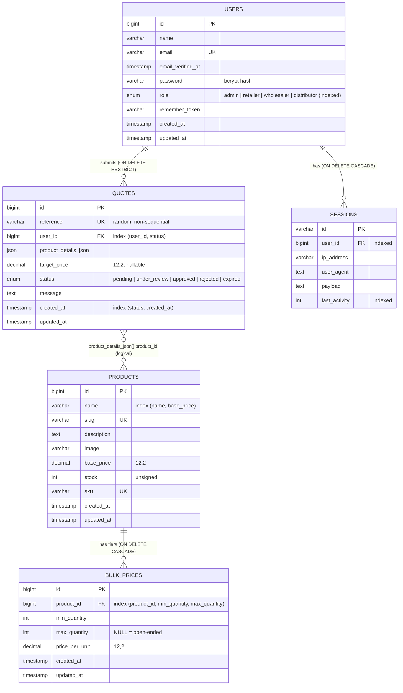

# Entity-relationship diagram

## Foreign keys

| Column | References | On delete | Index |
|---|---|---|---|
| `bulk_prices.product_id` | `products.id` | CASCADE | leading column of `(product_id, min_quantity, max_quantity)` |
| `quotes.user_id` | `users.id` | RESTRICT | leading column of `(user_id, status)` |
| `sessions.user_id` | `users.id` | CASCADE | `sessions_user_id_index` |

`quotes.product_details_json` refers to products **logically**, as a historical snapshot. It deliberately has no FK, so deleting a product never rewrites or blocks past quotes. Pages show "no longer listed" for such items.

## Row Level Security (Supabase)

RLS is **enabled on every table**, with **no policies**, and all privileges are revoked from `anon` and `authenticated` (migration `2026_11_05_000001`, mirrored in `database/schema.sql`). The Supabase Data API therefore cannot read or write any table with the publishable key. The Laravel application connects as the table owner, which is unaffected by RLS.

## Domain rules enforced outside the schema

- **Tier overlap**: no two tiers of a product may overlap (`StoreBulkPriceRequest::after()`).
- **Status transitions**: `QuoteStatus::allowedTransitions()`. Approved, rejected and expired are terminal.
- **Effective price**: `Product::getPriceForQuantity()` uses the matching tier with the highest `min_quantity`, otherwise `base_price`.
